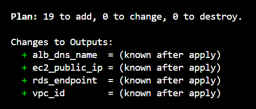

# Two-Tier AWS Infrastructure with Terraform

Infrastructure as Code project that provisions a two-tier AWS architecture using Terraform.

## Architecture

The project is designed around a secure two-tier architecture consisting of:

- Amazon VPC
- Public and private subnets
- Internet Gateway
- Route tables
- Security Groups
- EC2 application infrastructure
- Application Load Balancer
- Amazon RDS PostgreSQL

Traffic is designed to flow through the Application Load Balancer to the application tier, while the database remains in private subnets and is not directly exposed to the internet.

See the [architecture documentation](docs/architecture.md) for the architecture diagram and request flow.

## Technologies

- AWS
- Terraform
- Amazon VPC
- Amazon EC2
- Application Load Balancer
- Amazon RDS PostgreSQL
- AWS Security Groups
- Git
- GitHub

## Project Structure

```text
.
├── docs/
│   ├── architecture.md
│   └── screenshots/
│
├── compute.tf
├── database.tf
├── internet.tf
├── load-balancer.tf
├── main.tf
├── outputs.tf
├── provider.tf
├── security-groups.tf
├── subnets.tf
├── variables.tf
├── versions.tf
├── terraform.tfvars.example
├── .gitignore
└── .terraform.lock.hcl
```

## Validation

The Terraform configuration was successfully validated using `terraform validate`.

A Terraform plan was also generated successfully without deploying resources to AWS.

### Terraform Plan Evidence



## Project Highlights

- Designed a two-tier AWS architecture using Terraform.
- Created a custom VPC with separate public and private subnets across multiple Availability Zones.
- Configured an Internet Gateway and public routing for internet-facing resources.
- Implemented security groups with restricted communication between the ALB, application server, and database tiers.
- Provisioned an Amazon Linux EC2 application server with Apache using Terraform user data.
- Configured an Application Load Balancer with a target group and HTTP listener.
- Configured a private PostgreSQL RDS database in the private subnet tier.
- Used Terraform variables for configurable infrastructure settings and sensitive database credentials.
- Added Terraform outputs for important infrastructure information.
- Validated the infrastructure with `terraform validate` and `terraform plan`.
- Documented the architecture and validation results in GitHub.